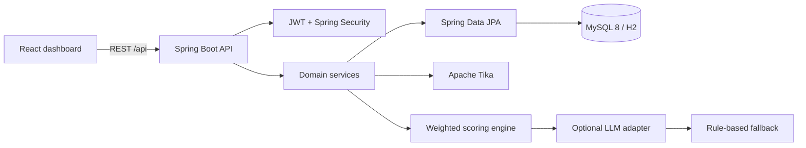
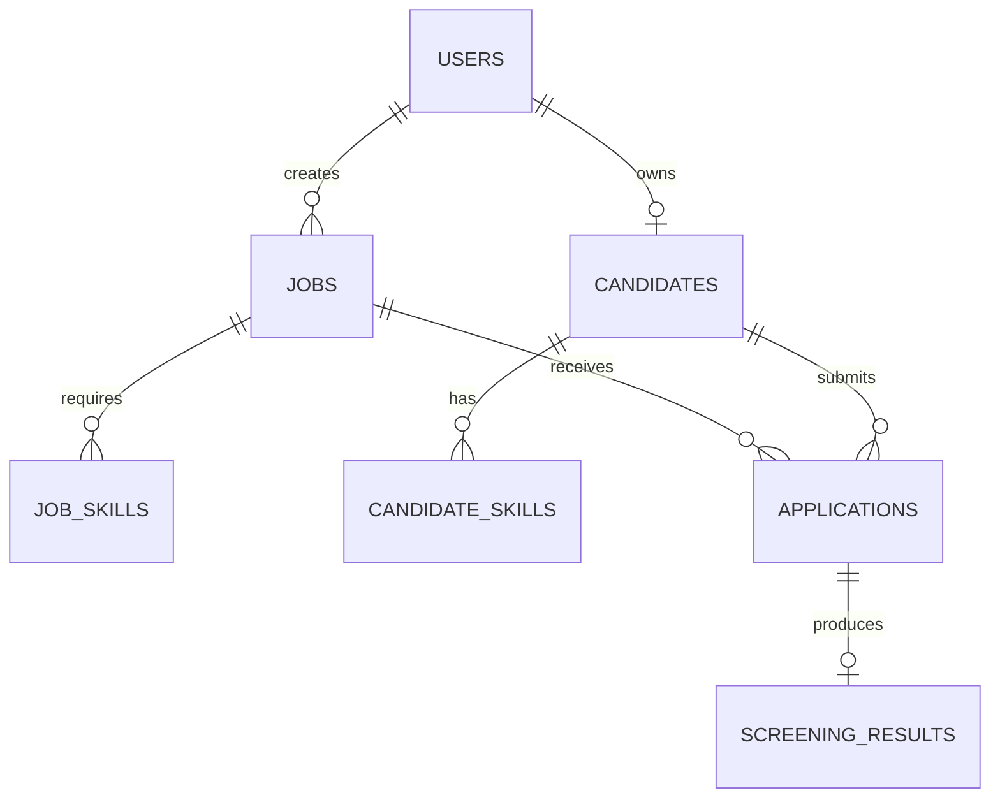

# AI-Powered Resume Screening System

Production-oriented full-stack application for extracting resume data, comparing candidates with job requirements, and explaining screening scores. Recruiters manage jobs and rankings; candidates manage profiles and applications.

## Features

- Stateless JWT authentication with BCrypt and recruiter/candidate roles
- PDF and DOCX text extraction through Apache Tika
- Candidate profile and skill normalization workflows
- Weighted screening scores: skills 40%, experience 25%, keywords 15%, education 10%, certifications 10%
- Explainable matched/missing skills, score breakdowns, recommendations, and ranking endpoints
- Optional OpenAI-compatible semantic analysis with a local rule-based fallback
- Responsive React dashboards for recruiter and candidate workflows
- H2 zero-configuration development profile and MySQL 8 Docker deployment

## Architecture





## Repository layout

```text
backend/    Spring Boot API, entities, services, tests, and database resources
frontend/   React/Vite dashboard and shared UI components
docs/       Postman collection
docker-compose.yml
```

## Requirements

- Java 21
- Maven 3.9+ or the included Maven wrapper
- Node.js 20+ and npm
- Docker Desktop, when running the full stack

## Run locally with H2

The default `dev` profile uses an in-memory H2 database and loads `backend/src/main/resources/data.sql` on startup. The demo dataset is recreated on each application restart.

```powershell
cd backend
.\mvnw.cmd spring-boot:run
```

Run the frontend in another terminal:

```powershell
cd frontend
npm install
npm run dev
```

Open `http://localhost:5173`. The H2 console is available at `http://localhost:8080/h2-console` with JDBC URL `jdbc:h2:mem:resumedb`, user `sa`, and an empty password.

## Run with Docker Compose

```powershell
docker compose up --build
```

The application is available at `http://localhost:3000`, the backend at `http://localhost:8080`, and the health check at `http://localhost:8080/api/health`.

Compose starts MySQL, the Spring Boot backend with the `mysql` profile, and the Nginx-served frontend. Set `DB_PASSWORD`, `JWT_SECRET`, and optionally `OPENAI_API_KEY` in a root `.env` file before deployment. The default compose database password is `root_password` and should be changed outside local development.

## Demo accounts

Every seeded account uses the password `Password123!`.

| Role | Email |
| --- | --- |
| Recruiter | `recruiter@demo.com` |
| Recruiter | `talent@northstar.example` |
| Candidate | `maya.chen@example.com` |
| Candidate | `daniel.ortiz@example.com` |
| Candidate | `priya.nair@example.com` |
| Candidate | `sam.wilson@example.com` |

These credentials are for local demonstration only. Replace or remove the seed data before exposing an environment to real users.

## API overview

All endpoints are relative to `http://localhost:8080/api`.

| Area | Endpoints |
| --- | --- |
| Auth | `POST /auth/register`, `POST /auth/login`, `GET /auth/me` |
| Jobs | `GET /jobs`, `POST /jobs`, `GET /jobs/{id}`, `PUT /jobs/{id}`, `DELETE /jobs/{id}` |
| Resumes | `POST /resumes/upload` |
| Candidates | `POST /candidates`, `GET /candidates`, `GET /candidates/{id}`, `GET /candidates/me` |
| Screening | `POST /screening/{jobId}/{candidateId}`, `GET /screening/{id}`, `GET /screening/jobs/{jobId}/rankings` |
| Skills | `POST /skills/normalize`, `POST /skills/extract`, `POST /skills/compare` |

Login returns a JWT. Send it on protected requests as `Authorization: Bearer <token>`.

## Configuration

| Variable | Purpose | Default |
| --- | --- | --- |
| `SPRING_PROFILES_ACTIVE` | Backend profile | `dev` |
| `DB_URL` | JDBC connection string | H2 dev URL |
| `DB_USERNAME` / `DB_PASSWORD` | Database credentials | `sa` / empty for H2 |
| `JWT_SECRET` | JWT signing secret | Development value in `application.yml` |
| `OPENAI_API_KEY` | Enables optional AI analysis | Empty, uses fallback |
| `UPLOAD_DIR` | Resume storage directory | `uploads/resumes` |

## Testing

```powershell
cd backend
.\mvnw.cmd test

cd ..\frontend
npm run build
```

The backend tests use H2 and cover authentication, screening, and skill extraction services. The Postman collection in `docs/postman_collection.json` provides an API smoke-test workflow.

## Production notes

- Use a long, randomly generated `JWT_SECRET` and rotate demo credentials.
- Store `DB_PASSWORD`, `OPENAI_API_KEY`, and other secrets in the deployment secret manager.
- Put the frontend and API behind HTTPS and restrict CORS to the deployed frontend origin.
- Move from Hibernate `ddl-auto: update` to versioned migrations before production schema changes.
- Persist the `mysql_data` and `resume_uploads` volumes and configure backups.
